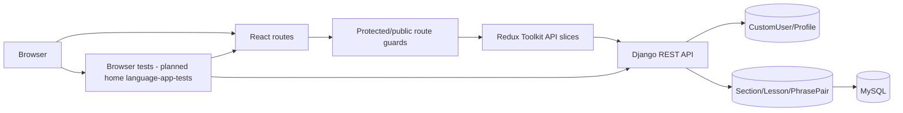

# Architecture

LanguageApp is maintained as four independent repositories under the LanguageAppSpace organization. This page describes the technical structure; [feature specifications](features/README.md) describe behavior from a user's point of view.

## Components

### Frontend

[language-app-frontend](https://github.com/LanguageAppSpace/language-app-frontend) contains the React 18 and TypeScript application. Vite provides the development server and production build. The frontend uses React Router for navigation, Redux Toolkit for shared state, Material UI and Emotion for interface components, and `react-i18next` for translations.

### Backend

[backend-learning-platform](https://github.com/LanguageAppSpace/backend-learning-platform) contains the Django and Django REST Framework application. It provides authentication, flashcard-based learning, and progress tracking APIs. Docker Compose runs the Django service together with MySQL.

### Tests

[language-app-tests](https://github.com/LanguageAppSpace/language-app-tests) is the planned home for shared browser and backend test suites. The migration is not complete: the existing suites still live in a pre-migration shared test workspace, and not all of its test files are committed. Do not assume a suite runs from the new repository yet.

Test instructions: pending migration to language-app-tests

### Documentation

[language-app-documentation](https://github.com/LanguageAppSpace/language-app-documentation) (this repository) holds product and architecture documentation that spans the other repositories. Implementation details stay in each repository's README.

## Request flow

At a high level:

```text
Browser
  │
  ▼
React/Vite frontend
  │ HTTP requests
  ▼
Django REST API
  │
  ▼
MySQL database
```

## Frontend boundaries

The frontend route table in [route.config.ts](https://github.com/LanguageAppSpace/language-app-frontend/blob/develop/src/config/route.config.ts) groups the product into four areas:

- Public pages: landing page, About Us, Contact, Support, Privacy Policy, and Learn More.
- Authentication: registration, login, password reset, and public-route protection.
- Authenticated workspace: dashboard, settings, sections, lesson authoring, and lesson selection.
- Learning sessions: browse, review, quiz, matching pairs, and written answer.

The [redux directory](https://github.com/LanguageAppSpace/language-app-frontend/tree/develop/src/redux) contains the API slices and client state. The main API slices are `authApiSlice`, `sectionsApiSlice`, `lessonsApiSlice`, and `userSettingsApiSlice`, built on a shared `apiSlice`.

## Backend boundaries

The backend URL configuration exposes these application areas:

| Area | URL prefix | Responsibility |
| --- | --- | --- |
| User | `/user/` | registration, JWT tokens, profile, password, deactivation, streaks |
| Flashcards | `/flashcards/` | sections, lessons, phrase pairs, progress |
| Statistics | `/stats/` | user statistics (`/stats/user-statistics/`); further reporting is planned, not implemented |
| API schema | `/schema/`, `/swagger/`, `/redoc/` | generated API documentation |

The interactive API documentation is served by the backend itself. When the backend runs locally, open `/swagger/` (for example `http://127.0.0.1:8000/swagger/`); the [backend README](https://github.com/LanguageAppSpace/backend-learning-platform/blob/main/README.md) describes how to start it. This repository does not yet include a written API reference.

The core learning data model is `CustomUser -> Section -> Lesson -> PhrasePair`. A new user receives an `Other` section through the backend `post_save` signal. A lesson can also have no section, although the product flow generally assigns lessons to a section. Lessons can additionally carry user-scoped `Tag` records; this is implemented in the backend only, and frontend tag authoring and filtering are pending.

## Delivery status by repository

Some capabilities are implemented in the backend before the frontend uses them. Status as of 2026-11-26, verified against backend `main` at `fd93263` and frontend `develop` at `21a533e`; check the live pull request lists for the [frontend](https://github.com/LanguageAppSpace/language-app-frontend/pulls) and [backend](https://github.com/LanguageAppSpace/backend-learning-platform/pulls) for anything newer.

| Capability | Backend (implemented) | Frontend (pending) |
| --- | --- | --- |
| Lesson tags | `Tag` model, `tags` on lessons, and repeated `?tag=` filtering on `/flashcards/lessons/` (BE #21, merged) | Not in `develop`: no tag input, display, or filter; no pull request is referenced here |
| Language lessons | `is_language_lesson`, `source_language`, and `target_language` with validation: both languages are required for a language lesson and must differ (BE #22, merged) | Not in `develop`: no language selection or filtering. Flashcard text-to-speech is a draft in [PR #59](https://github.com/LanguageAppSpace/language-app-frontend/pull/59) and does not use these fields yet |
| Section review | `review_count` on sections and `GET /flashcards/sections/{id}/review/` | Review banner and section-wide review route are open in [PR #58](https://github.com/LanguageAppSpace/language-app-frontend/pull/58), not merged |
| Session restoration | JWT token refresh endpoint `/user/token/refresh/` | Restoring the session after a page refresh is open in [PR #57](https://github.com/LanguageAppSpace/language-app-frontend/pull/57), not merged |

Do not describe a pending item as shipped behavior until its pull request is merged.

## System behavior



## Hosting and deployment

This section describes what the repositories configure, verified on 2026-11-26 against backend `main` at `fd93263` and frontend `develop` at `21a533e`. It does not describe the live infrastructure.

### Backend hosting

- **Containers.** [docker-compose.yml](https://github.com/LanguageAppSpace/backend-learning-platform/blob/main/docker-compose.yml) defines a `db` service (MySQL 8.0 with a named data volume and a health check) and a `web` service. `web` is built from [backend/Dockerfile](https://github.com/LanguageAppSpace/backend-learning-platform/blob/main/backend/Dockerfile) (Python 3.11), publishes port 8080, waits for a healthy database, and sets `DJANGO_ENV=production`. It reads settings from a `.env` file that is not in the repository. [docker-compose.dev.yml](https://github.com/LanguageAppSpace/backend-learning-platform/blob/main/docker-compose.dev.yml) is the development variant: `DJANGO_ENV=development` and port 8000.
- **Startup.** [django-setup.sh](https://github.com/LanguageAppSpace/backend-learning-platform/blob/main/backend/django-setup.sh) waits for the database, applies migrations, and collects static files. Outside development it starts Gunicorn (4 workers) on `$PORT`, defaulting to 8080. In development it also runs `makemigrations` and starts Django's development server on port 8000.
- **Configuration.** [settings.py](https://github.com/LanguageAppSpace/backend-learning-platform/blob/main/backend/backend/settings.py) reads `DJANGO_ENV`. `ci` uses an in-memory SQLite database and an in-memory email backend. `development` uses MySQL on the host `db`. Any other value uses MySQL with `DB_*` environment variables. The settings contain host and origin allow-lists, trust the `X-Forwarded-Proto` header for HTTPS detection, and mark the CSRF cookie secure outside development. Uploaded media is stored under `media`.
- **Deployment.** [deploy.yml](https://github.com/LanguageAppSpace/backend-learning-platform/blob/main/.github/workflows/deploy.yml) runs on every push to `main`, in the GitHub environment `production`. It connects to a server over SSH using repository secrets, pulls `main`, rebuilds and restarts the containers with `docker compose`, and runs `migrate`. It is a single job and does not wait for the separate [django-test.yml](https://github.com/LanguageAppSpace/backend-learning-platform/blob/main/.github/workflows/django-test.yml) workflow, which runs the Django tests with `DJANGO_ENV=ci` on Python 3.10.

### Frontend hosting

The [CI/CD workflow](https://github.com/LanguageAppSpace/language-app-frontend/blob/develop/.github/workflows/deploy.yml) runs `npm audit`, a TypeScript check, and ESLint. For the `main` and `develop` branches it then builds the app and deploys it to Netlify. The build receives the backend address `VITE_API` from a repository secret, and the branch selects which of two Netlify sites receives the build. [netlify.toml](https://github.com/LanguageAppSpace/language-app-frontend/blob/develop/netlify.toml) rewrites all paths to `index.html` so client-side routes work on reload.

### Not documented in source

These cannot be confirmed from the repositories and are not described here: the production domain, server provisioning, the reverse proxy and TLS setup, which Netlify site is production and which is staging, database backups, and which build is currently deployed.

## Source of truth

- User-visible behavior: the [feature specifications](features/README.md), the [feature register](features/feature-register.md), and executable tests.
- Runtime contracts: backend serializers/views, generated Swagger schema, and frontend API slices.
- Product intent: the Trello export and private Miro board, with implementation status verified against code.
- Visual design: the Miro board and the current frontend components.

When these sources disagree, record the discrepancy in the relevant feature page and create a follow-up task instead of silently rewriting the requirement.

The exact API base URL and authentication behavior should be documented alongside the relevant frontend and backend configuration when those contracts change.

## Change ownership

- Change page behavior, routing, or frontend state in the frontend repository.
- Change API behavior, authentication, models, or migrations in the backend repository.
- Change cross-repository test orchestration in the tests repository once the migration is complete.
- Update this documentation when setup, interfaces, or workflows change.

## Related documentation

- [Frontend README](https://github.com/LanguageAppSpace/language-app-frontend/blob/develop/README.md)
- [Backend README](https://github.com/LanguageAppSpace/backend-learning-platform/blob/main/README.md)
- [Product map](product-map.md)
- [Feature specifications](features/README.md)
- [Feature register](features/feature-register.md)
- [Release history](release-history.md)
